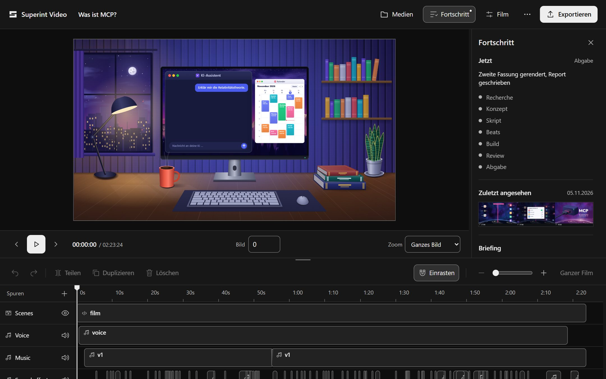
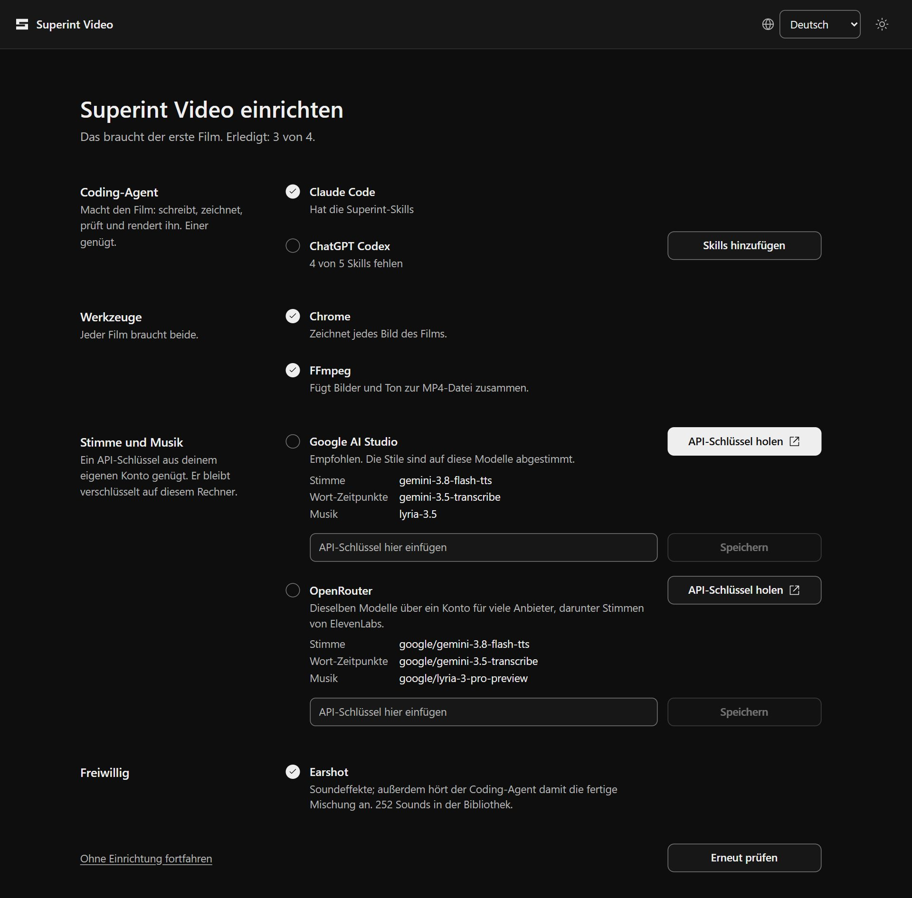
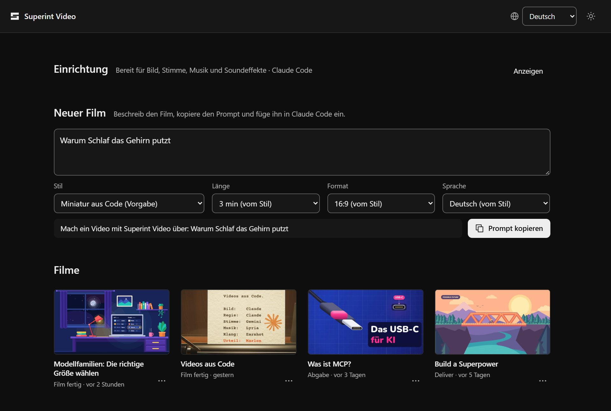

<a href="README.md">Deutsch</a>

<h1 align="center">Superint Video</h1>

  <b>Your coding agent makes videos for you.</b> 
  You say what the film is about. Claude Code, ChatGPT Codex or Google Antigravity researches, 
  writes, draws, voices and renders it, and you watch it happen. 
  Everything runs on your own PC, with no account and no subscription.

  
  
  
  

  <a href="https://github.com/marlonka/superint-video/releases/latest/download/Superint-Video-Setup.exe"><b>Download Superint Video for Windows</b></a>
  · <a href="https://github.com/marlonka/superint-video/releases/latest/download/Superint-Video-macOS.zip">for Mac</a>

  
   
  Studio with a finished film. You see what your coding agent is doing and change whatever you like yourself.

## How it works

Superint Video is not an editor where you build scenes yourself. It is the workshop for your coding agent: Claude Code, ChatGPT Codex or Google Antigravity find everything a film needs in it and build the film for you.

1. **You describe the film** in Superint Video. The app turns it into the prompt for your agent.
2. **You carry the prompt over.** Superint Video cannot send anything to your agent directly. This one step is yours: copy, paste into your agent, send.
3. **Your agent builds the film** with Superint Video's tools: it researches, writes, draws, voices, checks and renders.

Keep Superint Video open while it works. It then switches to the new film, and you see every step. If the app is closed, your agent opens Studio itself. You do not have to watch, though: it keeps working in the background until the MP4 is done.

## What you need

- **A Windows PC** with Windows 10 or 11 (64-bit) **or a Mac** with macOS 11 or later (Apple chip or Intel).
- **A coding agent:** [Claude Code](https://claude.com/product/claude-code), [ChatGPT Codex](https://openai.com/codex/) or [Google Antigravity](https://antigravity.google/), with your account there. It does the actual work on the film.
- **Chrome and FFmpeg.** If either is missing, the app installs it for you.
- **Optional: an API key** from Google AI Studio or OpenRouter, for an AI voice and music. Without one you narrate the film yourself, or it goes without a voice.

## Install

1. **Download:** [`Superint-Video-Setup.exe`](https://github.com/marlonka/superint-video/releases/latest/download/Superint-Video-Setup.exe)
2. **Double-click** the file. Windows may say "Windows protected your PC" because the program is not signed yet. Click **More info**, then **Run anyway**.
3. **Install:** keep "Create a desktop shortcut" ticked, click **Install**, then **Finish**. No administrator rights needed.
4. **Set up:** Superint Video opens with Setup. It shows only what is still missing, and every row has the one button that does it:
   - **Coding agent:** "Add the skills" shows your agent how to make films with Superint Video.
   - **Chrome and FFmpeg:** "Install" opens a window that gets them through winget.
   - **API key (optional):** paste it and save. It stays encrypted on your PC.

From then on you start Superint Video like any other program, from the desktop icon or the Start menu.

### On a Mac

1. **Download:** [`Superint-Video-macOS.zip`](https://github.com/marlonka/superint-video/releases/latest/download/Superint-Video-macOS.zip). Safari usually unpacks it by itself; otherwise double-click it.
2. **Drag it into Applications:** drag "Superint Video" from Downloads into the Applications folder.
3. **Open it:** double-click. The first time, macOS says it cannot verify the app because it has no Apple signature yet. Click **Done**, open **System Settings** → **Privacy & Security**, scroll down and click **Open Anyway** next to "Superint Video".
4. **Set up** as above. "Install" gets Chrome and FFmpeg through [Homebrew](https://brew.sh) in a Terminal window, so install Homebrew first. The API key is kept in a file only your user account can read.

  

## Your first film

1. Open Superint Video and write under **New film** what it should be about. One sentence is enough, such as "Why sleep cleans the brain".
2. Click **Copy prompt**.
3. Paste the prompt into Claude Code, ChatGPT Codex or Google Antigravity and send it. Keep Superint Video open.

Your agent asks if something is missing, then gets going: research, script, pictures, sound, polish and finally the MP4. Superint Video switches to the new film by itself, you see every step, and the preview grows as it works. You can change text and timing there yourself at any time. The finished film ends up in your `Videos\Superint Video` folder (on a Mac `Movies/Superint Video`).

  

For more ideas, see the [starter prompts](prompts/README.md). To see a result, watch the [launch film](https://github.com/marlonka/superint-video/releases/download/v0.3.0/superint-video-launch.mp4) (32 s, German, with sound) that Superint Video made about itself.

## Questions

**What does it cost?** Superint Video itself is free and open source. You need your coding agent, with its plan or credits. An API key is optional; Google AI Studio has a free tier with a daily limit.

**What films can I make?** Explainers, launch and update films for a product, short clips and loops. Three styles come with it: flat vector art, a photographic miniature world made in code, and a launch look. Under "Styles" you make a new one from your own pictures.

**Where are my films?** In `Videos\Superint Video` (on a Mac `Movies/Superint Video`), each film in a folder of its own. You can choose another place in Setup.

**How do I update?** Download the setup again and install it over the old one. On a Mac, replace the app in Applications with the new one. Films, settings and API keys stay. If Setup then offers "Update the skills", click it.

**How do I uninstall it?** In Windows Settings under **Apps** → **Installed apps** → **Superint Video** → **Uninstall**. Your films and settings stay.

**Can I use it without installing?** Yes. Download the ZIP from [Releases](https://github.com/marlonka/superint-video/releases/latest), unpack it (right-click → **Extract all**) and start `Superint Video.exe` inside. In Setup, "Add to desktop" puts the icon there. The other file, `superint-video.exe`, is the tool for your coding agent; you never need to open it yourself.

**My coding agent says `superint-video` cannot be opened on my Mac.** macOS is still holding on to the downloaded app. Type this once in Terminal: `xattr -dr com.apple.quarantine "/Applications/Superint Video.app"`.

**What doesn't work yet?** Windows is the most tested; the Mac version is new. Short films work well; very long projects, HDR and ripple editing do not yet. More in the (German) [manual](docs/HANDBUCH.md#grenzen).

**Something doesn't work?** See [troubleshooting](docs/HANDBUCH.md#fehler-beheben) in the manual or open an [issue](https://github.com/marlonka/superint-video/issues/new/choose).

## Privacy and AI content

Superint Video collects no usage data and needs no account. Pictures, Studio and renders stay on your PC. Only if you add an API key do the texts for the AI voice and music go to that provider, under its terms. What your coding agent does with your files is governed by its provider.

Voice and music usually come from generative models, and every MP4 says so in its metadata. When you publish a film, label it visibly as AI-assisted too, and only recreate a real voice with that person's consent.

## Read more

- [Manual](docs/HANDBUCH.md) (German): app, Studio, styles, sound, rendering, limits and troubleshooting
- [For developers](docs/DEVELOPERS.md): how it is built, every command, building from source
- [Changelog](CHANGELOG.md) (German) · [Contributing](CONTRIBUTING.md) · [Security](SECURITY.md)

## License and thanks

Superint Video is under the [MIT License](LICENSE). The launch workflow builds on [cinetic](https://github.com/Leonxlnx/cinetic), sound effects and hearing come from [Earshot](https://github.com/Leonxlnx/earshot), both by Leonxlnx under MIT. The fonts Nunito and Geist are under the SIL Open Font License. All dependencies and their licenses are in the [third-party notices](THIRD_PARTY_NOTICES.md).
