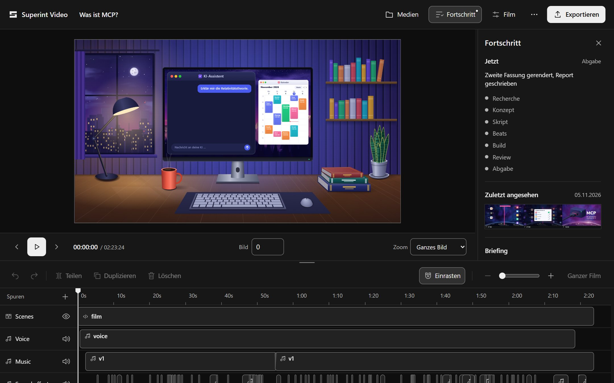
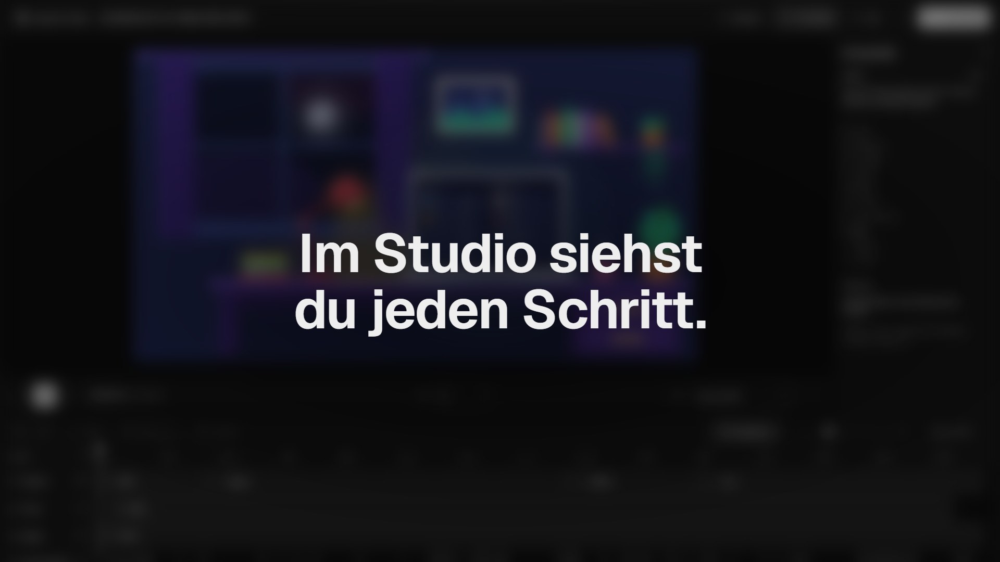
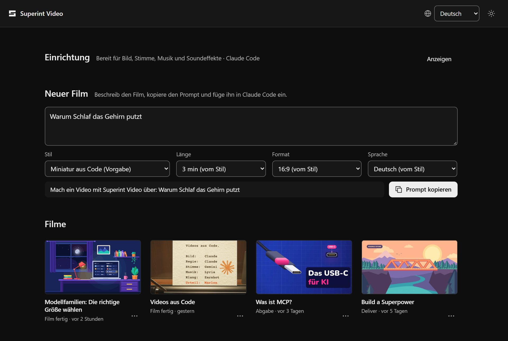
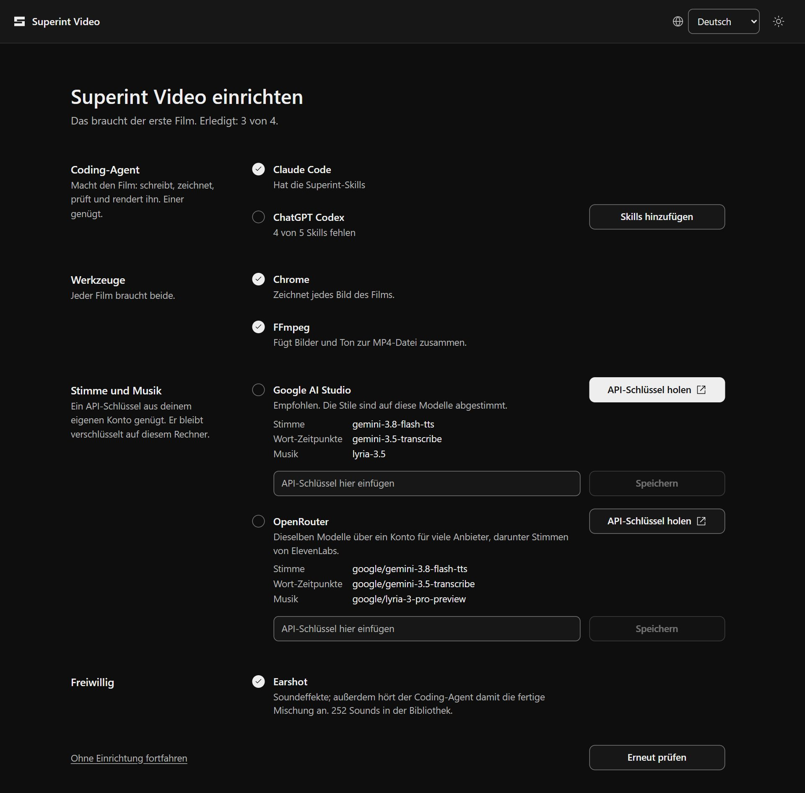
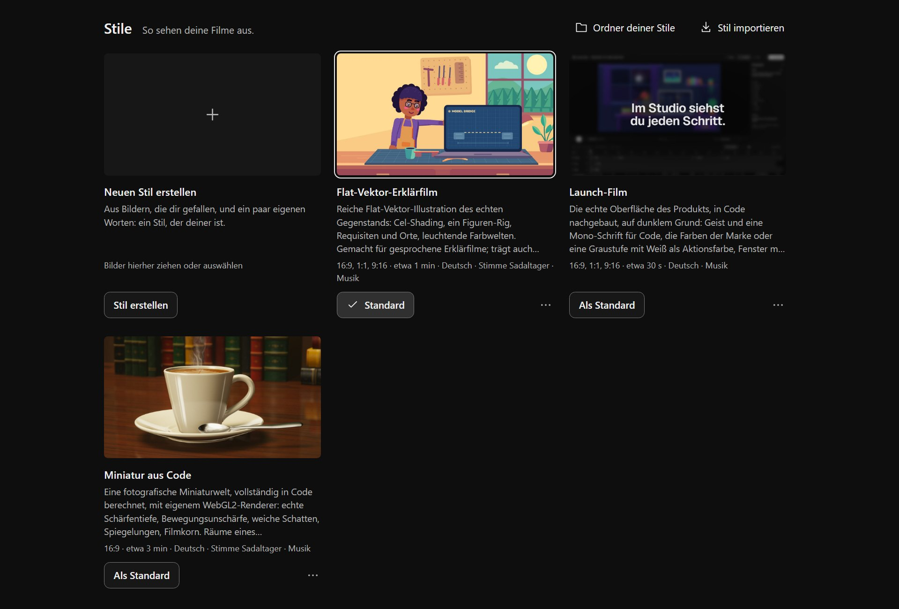

<p align="right"><a href="README.en.md">English</a></p>

<h1 align="center">Superint Video</h1>

<p align="center">
  <b>Dein Coding-Agent macht Videos: Erklärfilme, Launch-Filme, Loops, in jedem Stil.</b><br>
  HTML-Szenen, eine Timeline in JSON, ein Studio im Browser und am Ende ein MP4.<br>
  Lokal auf deinem Rechner, ohne Konto, ohne Credits, ohne Cloud-Renderdienst.
</p>

<p align="center">
  
  
  
  <a href="https://github.com/marlonka/superint-video/releases/tag/v0.3.0"></a>
</p>

<br>

<p align="center">
  
  <br>
  <sub>Das Studio mit einem fertigen Film. Du siehst, was dein Coding-Agent gerade tut, und änderst selbst, was du willst.</sub>
</p>

<p align="center">
  <a href="#so-entsteht-ein-film">So entsteht ein Film</a> ·
  <a href="#die-app">Die App</a> ·
  <a href="#drei-teile-ein-werkzeug">Drei Teile</a> ·
  <a href="#für-agenten-gebaut">Für Agenten</a> ·
  <a href="#unter-der-haube">Unter der Haube</a> ·
  <a href="#loslegen">Loslegen</a> ·
  <a href="docs/HANDBUCH.md">Handbuch</a>
</p>

<br>

<table>
  <tr>
    <td width="25%" valign="top">
      <h3>Jeder Stil</h3>
      Das Werkzeug hat keinen eigenen Geschmack. Was ein Film wird, bestimmen ein Ablauf-Skill, ein Stil-Preset und deine Referenzbilder.
    </td>
    <td width="25%" valign="top">
      <h3>Dein Agent führt Regie</h3>
      Claude Code oder ChatGPT Codex recherchiert, schreibt, zeichnet und prüft. Es gibt keinen eingebauten Chat, und für das Bild brauchst du keinen API-Key.
    </td>
    <td width="25%" valign="top">
      <h3>Ton mit Ohren</h3>
      Stimme, Wortzeiten, Musik und Klänge mit gemessener Lautheit. Weil der Agent nicht hören kann, hört Earshot für ihn gegen.
    </td>
    <td width="25%" valign="top">
      <h3>Zuschauen</h3>
      Studio öffnet sich mit dem Projekt. Du siehst Briefing, Stil, Skills und den aktuellen Schritt, die Vorschau lädt neu, sobald eine Szene dazukommt, und beim Rendern wächst der Film dort Bild für Bild.
    </td>
  </tr>
</table>

<br>

## So entsteht ein Film

Du sagst, was du willst, in welchem Stil und ungefähr wie lang. Ein Satz genügt:

```text
Nutze den Skill superint-video: Explainer im Flat-Vector-Stil, 60 Sekunden,
Thema „Warum Schlaf das Gehirn putzt“.
```

Der Agent fragt nur nach, was er nicht selbst gut entscheiden kann, etwa Screenshots des gewünschten Looks. Dann arbeitet er in Schritten, die jeweils eine Datei im Projekt hinterlassen: Recherche mit Quellen, drei Konzepte, Skript, Beats, Style-Frames, Szenen, Ton, Review, Polish und Render. Der Polish-Durchgang läuft von selbst vor jedem Render: Frische Augen sehen sich jedes Standbild, jeden Schnitt und jede Bewegung an und bessern nach, bis nichts mehr auffällt. Nach deiner Abnahme folgt ein Bericht mit einem Making-of zum Einfügen unter das Video.

- **Eine Welt statt Folien.** Jedes Bild ist eine reine Funktion der Zeit, und jede Bewegung hängt an einem Wort der Stimme. So fallen Bild und Wort auf den Frame genau zusammen.
- **Recherche, die trägt.** Jede Aussage im Film steht mit Quelle im Claim-Register. Drei Konzepte und drei Skriptentwürfe treten gegeneinander an, der beste geht durch Kritikrunden.
- **Ton, der sitzt.** Mehrere Takes pro Absatz, transkribiert und gegen das Skript gemessen. Die Musik folgt einer Zeitleiste aus den echten Wortzeiten, die Klänge sitzen auf ihren Frames, das Master liegt bei −14 LUFS.
- **Selbst Hand anlegen.** Text, Timing und Medien änderst du im Studio auf einer Timeline, mit Undo, Tastenkürzeln und Export. Dein Agent sieht die Änderungen sofort.

<p align="center">
  <a href="https://github.com/marlonka/superint-video/releases/download/v0.3.0/superint-video-launch.mp4"></a>
  <br>
  <sub><a href="https://github.com/marlonka/superint-video/releases/download/v0.3.0/superint-video-launch.mp4">Den Launch-Film ansehen</a> (32 s, mit Ton). Superint Video hat ihn selbst gemacht, im Stil <code>launch</code>.</sub>
</p>

## Die App

Ein Doppelklick auf `Superint Video.exe` öffnet die Startseite. Sie spricht Deutsch und Englisch.

<p align="center">
  
  <br>
  <sub>Thema eintippen, „Prompt kopieren“, in Claude Code oder ChatGPT Codex einfügen. Darunter stehen deine Filme mit ihrem Stand.</sub>
</p>

<table>
  <tr>
    <td width="50%" valign="top">
      
    </td>
    <td width="50%" valign="top">
      <h3>Einrichtung, die niemand übersieht</h3>
      Solange etwas fehlt, zeigt die App nur das: einen Coding-Agenten mit den Skills, Chrome und FFmpeg, einen API-Schlüssel für Stimme und Musik. Jede Zeile hat rechts den einen Knopf, der sie erledigt, und nennt die Modelle, die dein Schlüssel nutzt.
      <h3>Skills auf dem Stand der App</h3>
      Ein Klick kopiert die Skills in den Ordner deines Agenten. Nach einem Update der App steht dort „Skills aktualisieren“; was ersetzt wird, bleibt auf deinem Rechner erhalten.
      <h3>Filme an einem festen Ort</h3>
      Jeder Film ist ein Ordner mit allem, was zu ihm gehört, in <code>Videos\Superint Video</code>. Einen anderen Ordner stellst du unter „Vorgaben“ ein.
    </td>
  </tr>
</table>

<p align="center">
  
  <br>
  <sub>Stile unter „Vorgaben“: einen als Standard wählen, eigene Referenzbilder hinzufügen, eine Kopie anlegen, als Datei weitergeben oder eine solche Datei importieren.</sub>
</p>

## Drei Teile, ein Werkzeug

| Teil | Bestimmt | Mitgeliefert |
| --- | --- | --- |
| **Ablauf-Skill** | Welche Art Film, wie er geplant, geschrieben und geprüft wird | [`superint-explainer`](skills/superint-explainer/SKILL.md) für Erklärvideos, [`superint-launch`](skills/superint-launch/SKILL.md) für Launch-, Update- und Produktfilme (aufgebaut auf [cinetic](https://github.com/Leonxlnx/cinetic)) |
| **Stil-Preset** | Der Look: Farbe, Licht, Schrift, Formen, Figuren, Bewegung | `flat-explainer` (flache Vektorgrafik, Figuren, helle Farbwelten), `miniature-3d` (fotografische Miniaturwelt, ganz aus Code gerechnet, mit eigenem Skill [`superint-miniature`](skills/superint-miniature/SKILL.md)), `launch` (die echte Oberfläche deines Produkts in Code, für Launch- und Update-Filme mit Musik), `blank` (kein Hauslook, für dein Branding) |
| **Referenzen** | Woran der Agent seine Bilder misst | Deine Standbilder und Screenshots, am Preset oder im Projekt |

Dazu kommen der Werkzeug-Skill [`superint-video`](skills/superint-video/SKILL.md) und der Ton-Skill [`superint-audio`](skills/superint-audio/SKILL.md). Einen Stil gibst du als eine Datei weiter (`<name>.superint-style.zip`), aus der App oder mit `preset export` und `preset import`. Die Regeln in Skills und Presets sind eine Untergrenze, keine Obergrenze: Ein stärkeres Modell darf es besser machen und begründet das im Bericht.

## Für Agenten gebaut

Jeder Schritt ist ein Befehl, und jeder Befehl gibt JSON aus. Die CLI schreibt nie selbst Text: Jeden Prompt an Stimme oder Musik schreibt dein Agent.

```powershell
superint-video new .\schlaf --preset flat-explainer --topic "Warum Schlaf das Gehirn putzt" --seconds 60   # öffnet Studio; ohne Ordner landet der Film im Filme-Ordner
superint-video studio .\schlaf                  # holt Studio zurück
superint-video voice takes .\schlaf             # Takes pro Absatz, transkribiert und gemessen
superint-video music .\schlaf                   # Musikvarianten, gemessen
superint-video sfx kit .\schlaf                 # Klänge aus Earshot, auf die Frames gesetzt mit sfx place
superint-video mix .\schlaf                     # Ducking, Master auf −14 LUFS
superint-video review .\schlaf                  # Kontaktbogen und Arbeitsblatt für die Review-Runde
superint-video polish .\schlaf                  # letzter Blick vor dem Render: Standbilder, Nahaufnahmen, Schnitte, Bewegungen
superint-video polish .\schlaf --accept         # sauberen Durchgang festhalten; render verlangt ihn
superint-video render .\schlaf --audio audio/master.wav --output renders/video.mp4
superint-video listen .\schlaf\renders\video.mp4 --project .\schlaf   # gegenhören
```

Alle Befehle und Optionen stehen im [Handbuch](docs/HANDBUCH.md) und in `superint-video <befehl> --help`.

## Unter der Haube

- **Eine EXE und ein Starter:** `superint-video.exe` ist die Rust-CLI mit eingebettetem Studio (Svelte 5), Szenen-Runtime und Presets; `Superint Video.exe` öffnet die App per Doppelklick.
- **Deutsch und Englisch:** App und Studio folgen der Sprache deines Systems, der Globus oben rechts stellt um. Die Texte liegen in einem Katalog je Sprache; Zahlen, Zeiten und Aufzählungen schreibt der Browser so, wie die Sprache es verlangt.
- **Szenen sind HTML:** Jeder Frame sieht gleich aus, ob vorwärts, rückwärts oder nach einem Sprung abgespielt. `video.json` speichert alle Zeiten als ganze Frames.
- **Rendering:** Chrome nimmt die Bilder auf, mehrere Browser parallel; FFmpeg kodiert HEVC oder H.264 und prüft das Ergebnis.
- **Ton:** Der Anbieter ist Konfiguration: Google AI Studio (`gemini-3.8-flash-tts`, `gemini-3.5-transcribe`, `lyria-3.5`), dieselben Modelle über Google Cloud, oder OpenRouter. Jede Anfrage wird zwischengespeichert, und die API-Keys liegen verschlüsselt in der App oder in einer `.env`.
- **Geprüft:** Über 100 Tests. `scripts/build.ps1` baut und prüft alles lokal.

## Loslegen

1. Lade das ZIP aus den [Releases](https://github.com/marlonka/superint-video/releases/latest) und entpacke es.
2. Starte **`Superint Video.exe`**. Solange etwas fehlt, zeigt die App nur die Einrichtung. Jede Zeile hat rechts den einen Knopf, der sie erledigt:
   - **Coding-Agent:** Claude Code oder ChatGPT Codex. Ein Klick kopiert die Superint-Skills hinein. Von Hand gehören die Ordner aus `skills/` nach `%USERPROFILE%\.claude\skills\` oder `%USERPROFILE%\.codex\skills\`.
   - **Chrome** (oder Edge) und **FFmpeg:** Fehlt eines, installiert „Installieren“ es über winget in einem sichtbaren Terminal-Fenster. Die App stimmt dabei nichts für dich zu.
   - **Ein API-Schlüssel** von Google AI Studio oder OpenRouter für Stimme und Musik. Die Einrichtung nennt die Modelle, die damit laufen. Du trägst ihn dort ein, er bleibt verschlüsselt auf deinem Rechner.
   - [Earshot](https://github.com/Leonxlnx/earshot) für Soundeffekte ist freiwillig.
3. Wähl unter „Vorgaben“ deinen Stil und, wenn du magst, Länge, Format und Sprache.
4. Schreib unter „Neuer Film“, worum es gehen soll, kopiere den Prompt und füge ihn in Claude Code oder ChatGPT Codex ein. Der Film erscheint in der App, während er entsteht, und liegt danach in `Videos\Superint Video`.

Von der Kommandozeile prüfst du die Installation so:

```powershell
.\superint-video.exe doctor --json
```

Aus dem Quellcode: `git clone`, dann `.\scripts\build.ps1`. Dafür brauchst du Rust 1.99 und Node.js 26. Details stehen im [Handbuch](docs/HANDBUCH.md#aus-dem-quellcode-bauen).

> [!IMPORTANT]
> **Stand:** v0.3.0 ist veröffentlicht. Enthalten sind Presets, Ablauf-Skills, Ton und Produktionsbereich sowie die App mit Einrichtung, festem Filme-Ordner und Stil-Dateien. Geprüft ist nur Windows x64. App und Studio sprechen Deutsch und Englisch; Meldungen der Kommandozeile sind englisch. Kurze SDR-Filme funktionieren gut; lange Projekte, HDR und Ripple-Editing nicht. Die Grenzen stehen im [Handbuch](docs/HANDBUCH.md#grenzen).

## Datenschutz und KI-Inhalte

Superint Video sammelt keine Nutzungsdaten und braucht kein Konto. Bild, Studio und Render bleiben auf deinem Rechner. Für Stimme, Transkription und Musik gehen die Texte und Aufnahmen, die dein Agent dafür schreibt, an den Anbieter, den du eingerichtet hast (Google AI Studio, Google Cloud oder OpenRouter, fürs Diktat auch OpenAI), zu dessen Bedingungen. Bei der kostenlosen Stufe der Gemini API darf Google sie zur Verbesserung seiner Produkte nutzen. Was dein Coding-Agent mit deinen Dateien macht, regelt dessen Anbieter.

Stimme und Musik kommen meist aus generativen Modellen. Jedes exportierte MP4 sagt das in seinen Metadaten. Kennzeichne deine Filme beim Veröffentlichen auch sichtbar als KI-gestützt, und bilde echte Stimmen nur mit Einwilligung nach. Mehr dazu im [Handbuch](docs/HANDBUCH.md#datenschutz-und-ki-kennzeichnung).

## Dokumentation

- [Handbuch](docs/HANDBUCH.md): Installation, Studio, Presets, Prüfen und Rendern, Projektformat, Grenzen, Fehler beheben
- [Starter-Prompts](prompts/README.md) für Erklärvideos, Shorts, Launch-Filme, eigene Skripte und Änderungen
- [Szenen-API](skills/superint-video/references/scene-api.md), [Projektformat](docs/FORMAT.md), [JSON Schema](docs/video.schema.json)
- [Versionsverlauf](CHANGELOG.md) · [Mitmachen](CONTRIBUTING.md) · [Sicherheit](SECURITY.md)

## Lizenz und Dank

Superint Video steht unter der [MIT-Lizenz](LICENSE). Der Launch-Ablauf baut auf [cinetic](https://github.com/Leonxlnx/cinetic) auf, die Klänge und das Gehör kommen aus [Earshot](https://github.com/Leonxlnx/earshot), beide von Leonxlnx und unter MIT. Die Schriften Nunito und Geist stehen unter der SIL Open Font License. Alle Abhängigkeiten und ihre Lizenzen stehen in den [Drittanbieterhinweisen](THIRD_PARTY_NOTICES.md).
